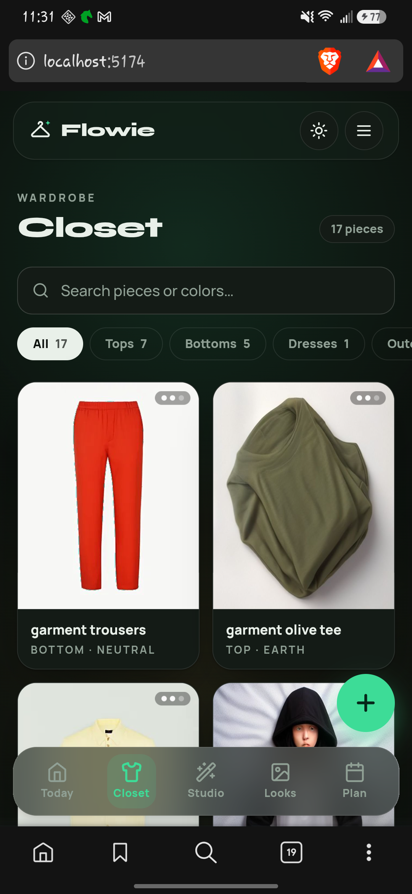

# Flowie

A mobile-first wardrobe and AI stylist PWA. Photograph your clothes, and Flowie
extracts each garment, renders it flat, and composes outfits for the day's
weather — previewed on a layered 2D avatar.

Built as a real product rather than a demo: it works offline, runs in mock mode
with no backend configured, and ships to Android through Capacitor.



## What it does

- **Closet** — import garment photos from camera or library, auto-analyse and
  crop each piece, then store it with category, colour and attributes.
- **Today** — weather-aware outfit suggestions (Open-Meteo, no API key). Gemini
  composes the look when keyed; a deterministic on-device heuristic engine takes
  over when it isn't, so the feature never dead-ends.
- **Studio** — flat-lay reconstruction: a garment photo becomes a clean,
  background-free render via a server-side pipeline (below).
- **Lookbook** — saved outfits with a layered mannequin preview.
- **Android** — the same Vite build wrapped by Capacitor; installable PWA too.

## Stack

| Layer | Choice |
|---|---|
| UI | React 18, TypeScript, Tailwind CSS v4, Framer Motion, lucide-react |
| State | Zustand + `persist` (single store, cloud write-through) |
| Routing | react-router-dom |
| Backend | Supabase — auth (email + Google OAuth), Postgres with RLS, storage |
| AI | Gemini 2.5 Flash (stylist), Gemini bbox analyzer (recon), Hugging Face Spaces (rendering) |
| Build | Vite 6, `vite-plugin-pwa`, Capacitor 8 (Android) |

## Getting started

Requires Node 20+.

```bash
npm install
cp .env.example .env    # optional — see below
npm run dev
```

With an empty `.env` the app boots in **mock mode**: a local demo dataset, a
fake auth flow in `localStorage`, and the heuristic stylist. No cloud account
or API key is needed to explore the UI.

```bash
npm run typecheck   # tsc --noEmit
npm test            # vitest
npm run build       # typecheck + production bundle
npx cap sync android && npx cap open android   # if you have the Android SDK
```

### Configuration

All variables are documented in `.env.example`. Nothing is required to run
locally; each block only unlocks its feature.

| Variable | Effect when set |
|---|---|
| `VITE_SUPABASE_URL`, `VITE_SUPABASE_ANON_KEY` | Real auth + cloud sync instead of mock mode. The anon key is client-side by design and protected by RLS (`supabase/schema.sql`). Never use a `service_role` key here. |
| `VITE_GEMINI_API_KEY` | Gemini outfit composition instead of the heuristic engine. |
| `HF_TOKEN`, `HF_TRYOFF_SPACE_ID`, `HF_KLEIN_SPACE_ID` | Server-side only. Enable garment reconstruction through the Supabase Edge Functions. |

Secrets for the Edge Functions (`HF_*`) are set in the Supabase dashboard, not
in the client bundle.

## How reconstructions work

1. The client uploads the photo and asks `recon-garment` (Supabase Edge
   Function) for a render.
2. Gemini locates the garment's bounding box; the client uploads a **crop-first**
   payload rather than the full frame.
3. The function calls a Hugging Face Space — TryOffDiff for the baseline,
   FLUX.2-klein for garments flagged `hasPrint` — and returns an image URL plus
   timing metadata.
4. Renders are cached per garment (`recon_url` / `studio_render_url`), and calls
   are budgeted per day so a free-tier quota can't be drained silently.

The Space-side code lives in `hf-tryoff/`, `hf-qwen/` and `hf-klein/`.

## Repository layout

```
src/            app code (screens, components, store, services)
supabase/       schema, migrations, Edge Functions
tools/          probe harnesses and gate scripts (CI evidence)
scripts/        recon harness
hf-*/           Hugging Face Space definitions (server side)
docs/           engineering spec, phase gate evidence, screenshots
android/        Capacitor Android project
```

## Known gaps

- Print and text fidelity on reconstruction is the open quality problem: the
  baseline renderer drops logos, and the detail renderer costs roughly twice the
  GPU time. Measured verdicts are in `docs/ENGINEERING_EXECUTION_SPEC.md`.
- Hugging Face free-tier ZeroGPU quota is small; the daily call budget exists
  because of it.
- The avatar is a stylised 2D layered mannequin, not a body-model try-on.

## Documentation

- `docs/ENGINEERING_EXECUTION_SPEC.md` — the authoritative engineering record:
  root causes, phase gates, evidence, and every place reality contradicted the
  plan.
- `docs/BASELINE.md` — pre-work measurements.
- `phase1-review/` … `phase3-review/` — reconstruction spikes and their source
  notes.

## License

MIT — see [LICENSE](LICENSE).
